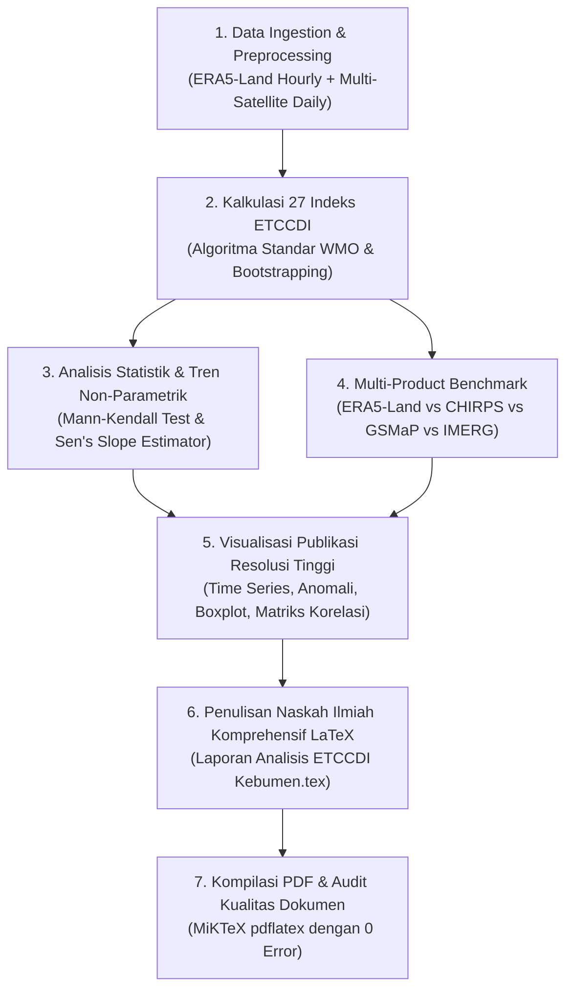

# Rencana Penelitian Komprehensif: 27 Indeks Iklim Ekstrem ETCCDI Kabupaten Kebumen (2000–2025)

## Deskripsi Tujuan & Konteks Penelitian
Penelitian ini bertujuan untuk melakukan analisis variabilitas dan tren iklim ekstrem jangka panjang (26 tahun, periode 2000–2025) di Kabupaten Kebumen (studi kasus: kawasan pesisir agroklimat Desa Jerukagung, Klirong) menggunakan standar resmi **27 Indeks Inti ETCCDI** (*Expert Team on Climate Change Detection and Indices*, WMO/WCRP/JCOMM).

Penelitian ini memadukan data reanalisis atmosfer resolusi tinggi **Copernicus ERA5-Land** (data jam-jaman terstandarisasi WMO 2000–2026 yang dikonversi ke waktu lokal Jakarta/WIB), dataset multi-satelit presipitasi (**CHIRPS, JAXA GSMaP, NASA GPM IMERG**), serta data validasi mikro stasiun cuaca darat **AWS IoT Jerukagung**. Seluruh analisis kuantitatif, tren statistik non-parametrik (Mann-Kendall & Sen's Slope), visualisasi beresolusi tinggi, serta naskah ilmiah akan disusun secara terstruktur dalam format **LaTeX** dan dikompilasi menjadi dokumen PDF siap publikasi pada folder `Google_Earth_Engine/Dokumen Analisis/Analisis ETCCDI Kebumen/`.

---

## Cakupan 27 Indeks Ekstrem ETCCDI yang Diteliti

### I. Indeks Suhu Udara Ekstrem (16 Indeks)
1. **TXx** (*Highest Max Temp*): Nilai maksimum tahunan dari suhu maksimum harian ($^\circ\text{C}$).
2. **TXn** (*Lowest Max Temp*): Nilai minimum tahunan dari suhu maksimum harian ($^\circ\text{C}$).
3. **TNx** (*Highest Min Temp*): Nilai maksimum tahunan dari suhu minimum harian ($^\circ\text{C}$).
4. **TNn** (*Lowest Min Temp*): Nilai minimum tahunan dari suhu minimum harian ($^\circ\text{C}$).
5. **SU** (*Summer Days*): Jumlah hari dalam setahun dengan $TX > 25^\circ\text{C}$ (dalam iklim tropis bernilai $\approx 365$ hari, dianalisis relevansinya terhadap stres termal).
6. **TR** (*Tropical Nights*): Jumlah hari dalam setahun dengan suhu minimum malam hari $TN > 20^\circ\text{C}$ (indikator penting ketidaknyamanan termal pesisir).
7. **FD** (*Frost Days*): Jumlah hari dengan $TN < 0^\circ\text{C}$ (bernilai 0 di wilayah tropis, membuktikan karakteristik termal bebas beku).
8. **ID** (*Ice Days*): Jumlah hari dengan $TX < 0^\circ\text{C}$ (bernilai 0 di wilayah tropis).
9. **TX10p** (*Cool Days*): Persentase hari ketika $TX < \text{persentil ke-10}$ (menggunakan jendela geser 5-hari berpusat pada kalender referensi 2001–2020).
10. **TX90p** (*Warm Days*): Persentase hari ketika $TX > \text{persentil ke-90}$ (hari panas siang hari).
11. **TN10p** (*Cool Nights*): Persentase hari ketika $TN < \text{persentil ke-10}$ (malam dingin).
12. **TN90p** (*Warm Nights*): Persentase hari ketika $TN > \text{persentil ke-90}$ (malam hangat/terik).
13. **WSDI** (*Warm Spell Duration Index*): Jumlah hari tahunan dalam periode minimal 6 hari berturut-turut dengan $TX > \text{persentil ke-90}$.
14. **CSDI** (*Cold Spell Duration Index*): Jumlah hari tahunan dalam periode minimal 6 hari berturut-turut dengan $TN < \text{persentil ke-10}$.
15. **DTR** (*Diurnal Temperature Range*): Rata-rata tahunan dari selisih suhu harian ($TX - TN$).
16. **GSL** (*Growing Season Length*): Panjang musim pertumbuhan vegetasi/tanaman (disesuaikan dengan pola agroklimat monsunal pesisir).

### II. Indeks Presipitasi / Curah Hujan Ekstrem (11 Indeks)
17. **Rx1day**: Curah hujan maksimum 1-hari tertinggi dalam setahun ($\text{mm}$).
18. **Rx5day**: Akumulasi curah hujan maksimum 5-hari berturut-turut dalam setahun ($\text{mm}$).
19. **SDII** (*Simple Daily Intensity Index*): Rasio total curah hujan basah terhadap jumlah hari basah ($RR \ge 1.0\text{ mm}$, satuan $\text{mm/hari}$).
20. **PRCPTOT**: Total akumulasi curah hujan tahunan dari seluruh hari basah ($RR \ge 1.0\text{ mm}$).
21. **R10mm** (*Heavy Precipitation Days*): Jumlah hari dengan curah hujan $\ge 10\text{ mm}$.
22. **R20mm** (*Very Heavy Precipitation Days*): Jumlah hari dengan curah hujan $\ge 20\text{ mm}$.
23. **R50mm / Rnnmm** (*Custom Extreme Threshold*): Jumlah hari hujan lebat ekstrem $\ge 50\text{ mm}$ (mengadopsi ambang batas resmi BMKG untuk hujan sangat lebat).
24. **R95pTOT** (*Very Wet Days*): Total curah hujan dari hari-hari sangat basah ($RR > \text{persentil ke-95}$ hari basah periode baseline).
25. **R99pTOT** (*Extremely Wet Days*): Total curah hujan dari hari-hari amat sangat basah ($RR > \text{persentil ke-99}$ hari basah periode baseline).
26. **CDD** (*Consecutive Dry Days*): Jumlah hari kering berturut-turut terpanjang dalam setahun ($RR < 1.0\text{ mm}$).
27. **CWD** (*Consecutive Wet Days*): Jumlah hari basah berturut-turut terpanjang dalam setahun ($RR \ge 1.0\text{ mm}$).

---

## User Review Required

> [!IMPORTANT]
> **Keputusan Metodologis Utama:**
> 1. **Periode Observasi & Baseline:**
>    - Periode analisis penuh: **2000–2025 (26 tahun penuh)**.
>    - Periode acuan dasar (*climatological baseline* untuk persentil ETCCDI): **2001–2020 (20 tahun standar WMO)**.
> 2. **Konversi Waktu Siklus Diurnal Lokal (WIB UTC+7):**
>    - Suhu maksimum harian ($TX$) terjadi pada siang/sore (13:00–14:00 WIB), dan suhu minimum ($TN$) terjadi sebelum fajar (05:00–06:00 WIB). Agregasi jam-jaman dilakukan pada jendela kalender lokal Jakarta (WIB) agar nilai ekstrem termodinamika atmosfer akurat secara fisik.
> 3. **Ambang Batas Kustom $Rnn\text{mm}$:**
>    - Ditetapkan $R50\text{mm}$ (hujan $\ge 50\text{ mm/hari}$) yang merupakan standar nasional BMKG untuk ancaman banjir dan genangan pesisir di Kebumen.
> 4. **Inter-Komparasi Multi-Satelit Presipitasi:**
>    - Selain menggunakan ERA5-Land sebagai *driver* kontinu suhu & hujan, 11 indeks presipitasi akan dikomparasikan secara kepala-ke-kepala (*inter-comparison*) dengan produk satelit operasional (**CHIRPS-v2, JAXA GSMaP, dan NASA IMERG**) yang tersedia di `Data_Curah_Hujan_Kebumen.csv`.

---

## Rencana Langkah Eksekusi (Work Breakdown)

### Tahap 1: Ekstraksi Data & Mesin Hitung ETCCDI
- **Lokasi Skrip**: `d:\Github\Projek_Rainfall\Google_Earth_Engine\Dokumen Analisis\Analisis ETCCDI Kebumen\scripts\compute_etccdi.py`
- Mengekstrak deret waktu harian ($TX, TN, TG, PR$) dari `ERA5_Land_Standard_Units_TimeSeries_UTC_WMO.csv` (234.270 baris jam-jaman dikonversi ke WIB).
- Mengintegrasikan data presipitasi satelit harian dari `Data_Curah_Hujan_Kebumen.csv`.
- Menghitung ke-27 indeks ETCCDI tahunan (2000–2025) secara vektorisasi menggunakan NumPy dan SciPy.
- Menyimpan hasil metrik tahunan ke dalam format CSV terstruktur (`etccdi_indices_annual_2000_2025.csv`).

### Tahap 2: Analisis Statistik Tren & Visualisasi Publikasi
- **Lokasi Skrip**: `d:\Github\Projek_Rainfall\Google_Earth_Engine\Dokumen Analisis\Analisis ETCCDI Kebumen\scripts\generate_etccdi_plots.py`
- Menghitung uji tren non-parametrik **Mann-Kendall ($Z$-score dan $p$-value)** serta laju perubahan tahunan **Sen's Slope** untuk setiap indeks.
- Menghasilkan 8 panel grafik publikasi resolusi tinggi (300 DPI) di folder `figures/`:
  1. `fig1_temperature_extremes_tчные.png`: Tren nilai absolut suhu ($TXx, TXn, TNx, TNn$).
  2. `fig2_temperature_percentiles.png`: Tren frekuensi hari & malam ekstrem ($TX10p, TX90p, TN10p, TN90p$).
  3. `fig3_spells_and_dtr.png`: Durasi gelombang panas ($WSDI$), gelombang dingin ($CSDI$), dan rentang suhu diurnal ($DTR$).
  4. `fig4_precipitation_maxima.png`: Tren curah hujan ekstrem harian ($Rx1day, Rx5day$).
  5. `fig5_precipitation_totals_and_intensity.png`: Total curah hujan basah ($PRCPTOT$) dan intensitas ($SDII$).
  6. `fig6_extreme_precipitation_days.png`: Hari hujan lebat ($R10mm, R20mm, R50mm$).
  7. `fig7_dry_wet_spells.png`: Periode kering beruntun ($CDD$) vs periode basah beruntun ($CWD$).
  8. `fig8_satellite_intercomparison_radar_corr.png`: Perbandingan performa satelit presipitasi dalam mendeteksi indeks ekstrem di Kebumen.

### Tahap 3: Penyusunan Dokumen Riset LaTeX & Kompilasi PDF
- **Folder Kerja**: `d:\Github\Projek_Rainfall\Google_Earth_Engine\Dokumen Analisis\Analisis ETCCDI Kebumen\`
- **Berkas Dokumen**: `Analisis_ETCCDI_Kebumen.tex`
- **Struktur Dokumen (Format Artikel Ilmiah Standard Springer/Elsevier):**
  - **Judul**: *Karakteristik dan Tren Perubahan Iklim Ekstrem Berdasarkan 27 Indeks Inti ETCCDI di Wilayah Pesisir Kabupaten Kebumen (2000–2025)*
  - **Afiliasi Penulis**: Evan Alif Widhyatma, Universitas Putra Bangsa.
  - **Bab 1: Pendahuluan**: Latar belakang hidrometeorologi pantai selatan Jawa, ancaman rob/siklon tropis Samudra Hindia, pentingnya baseline 26 tahun.
  - **Bab 2: Data dan Metodologi**: Deskripsi ERA5-Land, CHIRPS, GSMaP, IMERG, AWS IoT Jerukagung, formulasi matematis ke-27 indeks ETCCDI, uji Mann-Kendall & Sen's Slope.
  - **Bab 3: Hasil dan Pembahasan - Ekstrem Termal**: Analisis ke-16 indeks suhu (pemanasan malam vs siang, tren DTR, ketiadaan frost, lonjakan malam tropis TR).
  - **Bab 4: Hasil dan Pembahasan - Ekstrem Presipitasi**: Analisis ke-11 indeks curah hujan (perubahan durasi kering CDD, frekuensi R50mm, intensitas SDII, serta diskrepansi antar-satelit).
  - **Bab 5: Implikasi Sosio-Ekologis & Agroklimat**: Dampak terhadap kalender tanam padi sawah pesisir, produktivitas pertanian, dan kerentanan banjir genangan di Kebumen.
  - **Bab 6: Kesimpulan**: Sintesis temuan ilmiah dan rekomendasi mitigasi iklim lokal.
  - **Tabel Lengkap**: Tabel ringkasan 27 indeks berisi nilai rata-rata, nilai ekstrem historis, nilai $Z$ Mann-Kendall, $p$-value, dan Sen's Slope.
  - **Daftar Pustaka**: Referensi ilmiah standar IPCC, WMO ETCCDI (Zhang et al.), dan literatur iklim maritim Indonesia.

---

## Rencana Verifikasi

### Pengujian Otomatis
1. **Validasi Perhitungan Matematis:**
   - Memastikan tidak ada nilai `NaN` atau `Inf` pada seluruh 27 indeks sepanjang 26 tahun.
   - Memverifikasi batasan fisik: $TX \ge TN$, $WSDI \ge 0$, $CSDI \ge 0$, $R99pTOT \le R95pTOT \le PRCPTOT$.
   - Memverifikasi bahwa indeks $FD$ dan $ID$ bernilai tepat 0 (konsisten dengan wilayah lintang tropis).
2. **Kompilasi LaTeX Bebas Error:**
   - Menjalankan `pdflatex` sebanyak 2 kali untuk memastikan seluruh referensi silang (cross-references), nomor gambar, dan daftar isi terindeks sempurna.
   - Memastikan berkas PDF dihasilkan tanpa pemotongan teks (*overfull hbox* minimal) dan semua gambar tersemat tajam.

### Verifikasi Pengguna
- Memeriksa kelengkapan berkas `Analisis_ETCCDI_Kebumen.pdf` yang dihasilkan di folder `Google_Earth_Engine/Dokumen Analisis/Analisis ETCCDI Kebumen/`.
- Memeriksa kesesuaian tabel 27 indeks dan grafik tren.
