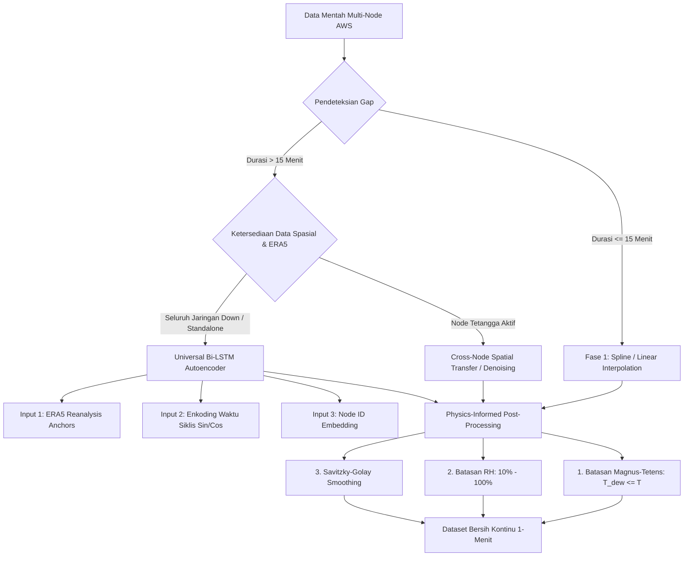

# Rencana Arsitektur & Implementasi: Universal Long-Range Bi-LSTM Meteorological Imputation Framework

Dokumen ini merinci arsitektur, metodologi, dan rencana implementasi modul **Framework Imputasi Jangka Panjang Berbasis Bi-LSTM** pada folder [`Model_Imputasi`](file:///d:/Github/Projek_Rainfall/Model_Imputasi) untuk seluruh node AWS IoT Jerukagung (`id-01`, `id-02`, `id-03`, `id-05`).

---

## 1. Latar Belakang & Urgensi

Data stasiun cuaca mikro AWS IoT (resolusi 1 menit) sering mengalami *gap* / kehilangan data dengan berbagai durasi:
1. **Micro-Gaps ($\le 15$ menit)**: Disebabkan oleh *packet drop*, tabrakan transmisi LoRaWAN, atau *reboot* singkat perangkat gateway.
2. **Macro-Gaps ($> 15$ menit s.d berjam-jam/berhari-hari)**: Disebabkan oleh pemadaman listrik berkepanjangan, pengurasan daya baterai surya saat cuaca mendung berhari-hari, atau pemeliharaan fisik sensor.

Pendekatan imputasi konvensional (seperti *Forward-Fill* atau Interpolasi Linier murni) gagal pada *macro-gaps* karena tidak mampu merekonstruksi dinamika siklus harian (*diurnal cycle*), pendinginan radiatif malam hari, serta perubahan tekanan semidiurnal. Oleh karena itu, diperlukan **Framework Hibrida 2-Fase Universal** berbasis Deep Learning **Bidirectional LSTM** yang terintegrasi.

---

## 2. Arsitektur Framework Universal



### 🌟 Komponen Inti Framework:

1. **Phase 1 (Micro-Imputer $\le 15$ menit)**:
   * Menggunakan interpolasi polinomial *Hermite Spline* lokal untuk kontinuitas instan dengan kompleksitas komputasi $O(1)$.
2. **Phase 2 (Deep Universal Bi-LSTM Macro-Imputer $> 15$ menit)**:
   * **Multi-Input Topology**:
     - *Continuous Stream*: Sensor target dengan *observation mask* + ERA5 *reanalysis* terinterpolasi 1 menit.
     - *Cyclic Time Stream*: $\sin\left(\frac{2\pi \cdot t}{T}\right)$ dan $\cos\left(\frac{2\pi \cdot t}{T}\right)$ untuk jam ($T=24$), hari dalam tahun ($T=365$), dan fase matahari.
     - *Categorical Stream*: `layers.Embedding(num_nodes=8, embedding_dim=4)` untuk membedakan mikroklimat tiap node.
   * **Sequence Horizon**: Lookback `LOOKBACK = 120` (2 jam horizon lokal) sesuai standar aturan dependensi ACF/PACF repository.
   * **Loss Function**: *Mask-Weighted Mean Squared Error* (hanya menghitung gradien pada titik observasi nyata).
3. **Phase 3 (Cross-Node Spatial Transfer Engine)**:
   * Modul *Ridge Spatial Transfer* dinamis berbobot siklus harian jika ada stasiun tetangga (misal `id-05` memandu `id-03`) yang aktif selama masa *downtime*.
4. **Phase 4 (Physics-Informed Sanitizer & Smoother)**:
   * Mengunci hukum termodinamika atmosfer: $T_{\text{dew}} \le T_{\text{ambient}}$, $10\% \le RH \le 100\%$, $P \in [900, 1050]\text{ hPa}$.
   * Menerapkan filter *Savitzky-Golay* untuk menghilangkan *jitter* kuantisasi sensor tanpa *phase lag*.

---

## 3. Struktur Modul & Berkas yang Akan Dibuat

Semua berkas akan diorganisasi secara modular di dalam [`d:\Github\Projek_Rainfall\Model_Imputasi/`](file:///d:/Github/Projek_Rainfall/Model_Imputasi):

```
Model_Imputasi/
├── framework/
│   ├── __init__.py
│   ├── preprocessor.py       # Penskalaan, enkoding siklis, QC batasan fisik, & pembentukan mask
│   ├── network.py            # Arsitektur Keras Universal Multi-Input Bi-LSTM Autoencoder
│   ├── spatial_transfer.py   # Engine transfer spasial multi-node & Ridge dinamis
│   ├── physics_postprocess.py# Magnus-Tetens enforcer & Savitzky-Golay smoothing
│   └── evaluator.py          # Perhitungan metrik MAE, RMSE, R2, NSE, KGE multi-rate gap
│
├── train_universal_bilstm.py  # Skrip training standalone (bisa jalan lokal / Kaggle GPU)
├── impute_pipeline.py         # Skrip CLI / API inferensi otomatis (Input data bolong -> Output data mulus)
├── benchmark_evaluation.py    # Skrip benchmark eksperimen (dropout 10%, 20%, 30%, 40%, 50%)
└── inferensi_demo.ipynb       # Jupyter notebook interaktif untuk demonstrasi visual & analisis
```

---

## 4. Rencana Verifikasi & Validasi

1. **Synthetic Dropout Experiment**:
   * Melakukan simulasi kehilangan data buatan (*artificial dropout*) pada data valid sebesar **10%, 20%, 30%, 40%, dan 50%**.
   * Menghitung 5 metrik standar hidrometeorologi internasional:
     - $R^2$ (*Coefficient of Determination*) $\ge 0.95$
     - $\text{MAE}$ & $\text{RMSE}$
     - $\text{NSE}$ (*Nash-Sutcliffe Efficiency*) $\ge 0.90$
     - $\text{KGE}$ (*Kling-Gupta Efficiency*) $\ge 0.88$
2. **Visualisasi Transisi Multi-Hari**:
   * Menghasilkan plot multi-panel 300 DPI yang menunjukkan sambungan mulus antara data asli, gap yang diimputasi Bi-LSTM, dan batas termodinamika.
3. **Standarisasi Kompatibilitas Kaggle**:
   * Mengintegrasikan deteksi lingkungan dinamis CuPy/NumPy (`xp`) sesuai aturan di `.agents/AGENTS.md`.
