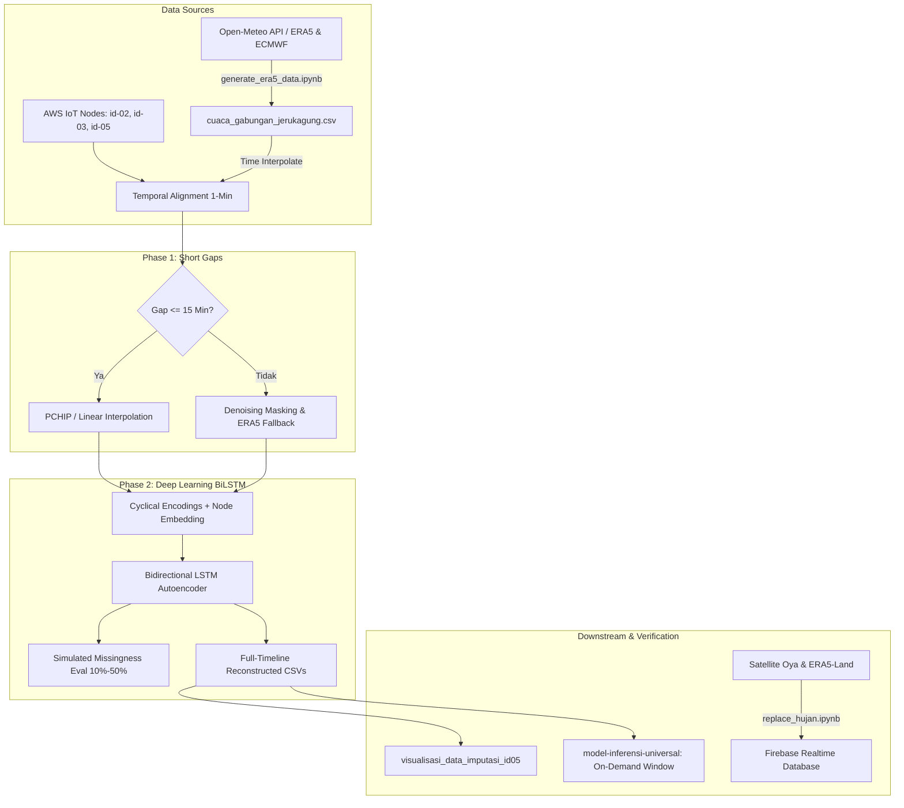

# Laporan Audit & Telaah Komprehensif: Direktori `Model_Imputasi`

Dokumen ini menyajikan hasil pemeriksaan mendalam (*deep audit*) terhadap seluruh berkas, arsitektur data, model *Deep Learning*, alur inferensi, dan visualisasi pada direktori `d:\Github\Projek_Rainfall\Model_Imputasi`.

---

## 1. Arsitektur & Ekosistem `Model_Imputasi`

Direktori `Model_Imputasi` merupakan modul inti untuk rekonstruksi dan imputasi data deret waktu stasiun cuaca otomatis (*Automatic Weather Station* / AWS) berbasis IoT di Jerukagung yang mengalami kekosongan (*data gaps*) akibat kendala transmisi, pemadaman daya, atau anomali sensor.



### 5 Alur Kerja Utama:
1. **Penyusunan Data Auxiliari Reanalisis (`generate_era5_data.ipynb`)**:
   - Mengambil data historis ERA5 reanalysis dan prakiraan ECMWF IFS dari Open-Meteo API untuk koordinat Jerukagung (`-7.7367, 109.6461`).
   - Menggabungkan data per jam ke dalam `cuaca_gabungan_jerukagung.csv` (2023 s.d. 2026, 30.840 baris).
2. **Pelatihan Model Imputasi Universal (`model-imputasi-universal.ipynb` & `.py`)**:
   - Menyelaraskan seluruh node AWS (`id-02`, `id-03`, `id-05`) ke grid waktu resolusi 1 menit.
   - **Phase 1**: Mengisi gap pendek ($\le 15$ menit) menggunakan interpolasi PCHIP/linear.
   - **Phase 2**: Melatih model **Bidirectional LSTM** 2-layer dengan *Node Embedding Layer* (mendukung multi-stasiun sekaligus) dan *Cyclical Time Features* (`hour_sin/cos`, `doy_sin/cos`, `month_sin/cos`).
   - Mengevaluasi model pada simulasi kekosongan bertingkat (10%, 20%, 30%, 40%, 50%) menggunakan metrik MAE, RMSE, $R^2$, NSE, KGE, dan Bias.
   - Merekonstruksi dan mengekspor dataset penuh: `id-*_imputed.csv`.
3. **Inferensi Imputasi Berbasis Jendela Rentang Waktu (`model-inferensi-universal.ipynb`)**:
   - Memungkinkan pengguna menentukan sembarang rentang waktu (`START_DATETIME` s.d. `END_DATETIME`) dan `NODE_ID`.
   - Mengimplementasikan 5 tingkat *Meteorological Quality Control (QC)*: Bounds Check (Flag 1), Hampel Filter Spike Check (Flag 2), Freeze Check (Flag 3), Rate of Change Jump Check (Flag 4), dan ERA5 Inconsistency Check (Flag 5).
   - Melakukan prediksi berbasis *overlapping sliding window* dengan *padding* kontekstual $\pm 120$ menit.
4. **Imputasi & Pengunggahan Curah Hujan ke Firebase (`replace_hujan.ipynb`)**:
   - Menggabungkan estimasi hujan Satelit Oya/GSMaP/IMERG dengan variabel ERA5-Land.
   - Menghitung *rainrate* (30 menit) dan akumulasi harian *rainfall* (reset jam 07:00 WIB / 00:00 UTC).
   - Mengunggah data secara *batch* ke Firebase Realtime Database (`/auto_weather_stat/{STATION_ID}/data`).
5. **Visualisasi Publikasi & Diagnostik (`visualisasi_data_imputasi_id05.ipynb` & `.py`)**:
   - Menghasilkan 8 visualisasi komprehensif: *Data Source Donut*, *Time-Series Overview*, *Diurnal Cycle ($\pm 1\sigma$ band)*, *KDE Distribution Comparison*, *Variability Heatmap*, *Zoom-in LSTM Gaps*, *Correlation Matrix*, dan *Rolling Volatility*.

---

## 2. Temuan Audit: "Apakah Ada yang Kurang / Perlu Diperbaiki?"

Berdasarkan analisis mendalam baris demi baris, ditemukan beberapa poin kritis, inkonsistensi, dan kekurangan yang perlu disempurnakan:

### 🔴 1. Bug Kritis: Ketidakcocokan Dimensi Fitur (*Feature Dimension Mismatch*) antara Training dan Inferensi
* **Lokasi**: [model-imputasi-universal.ipynb](file:///d:/Github/Projek_Rainfall/Model_Imputasi/model-imputasi-universal.ipynb#L575-L585) vs [model-inferensi-universal.ipynb](file:///d:/Github/Projek_Rainfall/Model_Imputasi/model-inferensi-universal.ipynb#L1816-L1822).
* **Masalah**:
  - Pada **Training** (`model-imputasi-universal.ipynb`), kolom ERA5 yang dipilih hanya **4 kolom**:
    `['temperature_2m', 'relative_humidity_2m', 'dew_point_2m', 'pressure_msl']`.
    Total fitur input continuous yang dibentuk untuk `scaler_X` dan model LSTM adalah **18 kolom** (4 Mask + 4 Filled Target + 4 ERA5 + 6 Cyclical Time).
  - Pada **Inferensi** (`model-inferensi-universal.ipynb` Cell 9), `era5_req_cols` meminta **9 kolom**:
    `['temperature_2m', 'relative_humidity_2m', 'dew_point_2m', 'pressure_msl', 'wind_speed_10m', 'wind_direction_10m', 'cloud_cover', 'shortwave_radiation', 'rain']`.
    Total fitur menjadi **23 kolom** (4 Mask + 4 Filled Target + 9 ERA5 + 6 Cyclical Time).
* **Dampak**: Jika inferensi dijalankan dengan 9 kolom ERA5 tersebut, `scaler_X.transform()` dan `model.predict()` akan langsung melempar error:
  `ValueError: X has 23 features, but MinMaxScaler is expecting 18 features`.
* **Solusi**: Samakan definisi `era5_req_cols` pada `model-inferensi-universal.ipynb` menjadi 4 kolom yang persis sama dengan model latih.

---

### 🟡 2. Inkonsistensi Batas Fisik (*Physical Bounds & Quality Control Inconsistency*)
Terdapat 3 definisi batas fisik meteorologi yang berbeda dan tidak sinkron di dalam berkas-berkas:
1. **Training Ingestion QC** (`model-imputasi-universal.ipynb` Cell 10):
   - `temperature`: $(15.0, 45.0)$ °C
   - `humidity`: $(40.0, 100.0)$ %
   - `pressure`: $(1002.0, 1019.0)$ hPa *(Sangat ketat untuk dataran rendah tropis)*
   - `dewpoint`: $(15.0, 35.0)$ °C
2. **Inference QC** (`model-inferensi-universal.ipynb` Cell 11):
   - `temperature`: $(-10.0, 60.0)$ °C *(Terlalu longgar untuk iklim tropis Kebumen)*
   - `humidity`: $(0.0, 100.0)$ %
   - `pressure`: $(850.0, 1100.0)$ hPa
   - `dewpoint`: $(-10.0, 60.0)$ °C
3. **Post-Prediction Clipping** (`model-imputasi-universal.ipynb` Cell 35 vs `model-inferensi-universal.ipynb` Cell 15):
   - Training: `pressure` di-*clip* ke $(1000.0, 1019.0)$.
   - Inference: `pressure` di-*clip* ke $(995.0, 1025.0)$, `humidity` ke $(30.0, 100.0)$.
* **Rekomendasi**: Standarisasi batas fisik meteorologi tropis Kebumen (misal: Tekanan $995.0 - 1020.0$ hPa, Suhu $18.0 - 42.0$ °C, RH $35.0 - 100.0$ %) ke dalam satu konfigurasi terpusat.

---

### 🟡 3. Penanganan Jalur Berkas (*Path Fallback*) pada Skrip Visualisasi
* **Lokasi**: [visualisasi_data_imputasi_id05.ipynb](file:///d:/Github/Projek_Rainfall/Model_Imputasi/visualisasi_data_imputasi_id05.ipynb#L2502-L2524)
* **Masalah**:
  `DATA_PATH = r'D:\Github\Projek_Rainfall\Analisis_Meteorologi\cache_data\id-05_imputed.csv'`
  Jika pipeline training menyimpan hasil ke `Model_Imputasi/outputs/imputed_data/id-05_imputed.csv` (atau jika berkas belum dipindahkan ke `Analisis_Meteorologi/cache_data`), skrip visualisasi langsung gagal dengan `FileNotFoundError`.
* **Solusi**: Tambahkan *dynamic path fallback* pada skrip visualisasi:
  ```python
  candidates = [
      r"D:\Github\Projek_Rainfall\Analisis_Meteorologi\cache_data\id-05_imputed.csv",
      r"D:\Github\Projek_Rainfall\Model_Imputasi\outputs\imputed_data\id-05_imputed.csv",
      r"outputs/imputed_data/id-05_imputed.csv"
  ]
  DATA_PATH = next((p for p in candidates if os.path.exists(p)), candidates[0])
  ```

---

### 🟡 4. Perlakuan Khusus Variabel Hujan (*Precipitation Handling*)
* **Status**: Variabel curah hujan (`rain`) sengaja tidak dimasukkan ke dalam `TARGET_VARS` BiLSTM (`temperature`, `humidity`, `pressure`, `dewpoint`) karena sifat hujan yang *zero-inflated* dan diskrit.
* **Kekurangan**: Belum ada dokumentasi atau modul penggabung (*merger*) otomatis yang menyatukan hasil imputasi 4 variabel termodinamika (`id-*_imputed.csv`) dengan data hujan hasil olahan `replace_hujan.ipynb` ke dalam satu master dataset stasiun yang utuh.

---

### 🟢 5. Redundansi Kode & Sinkronisasi Notebook vs Python File
* Pada `model-imputasi-universal.ipynb` Cell 31, terdapat baris `with strategy.scope():` ganda pada awal cell dan di baris 966 yang bersifat redundan.
* Berkas `.py` dan `.ipynb` perlu dipastikan selalu tersinkronisasi setelah perbaikan diterapkan.

---

## 3. Tabel Ringkasan Status Komponen

| Komponen / Berkas | Fungsi Utama | Status | Catatan / Hal yang Kurang |
| :--- | :--- | :---: | :--- |
| `generate_era5_data.ipynb` | Fetch & gabung ERA5 + ECMWF | ✅ **Lengkap** | Berfungsi sempurna, menghasilkan 30.840 baris data valid. |
| `cuaca_gabungan_jerukagung.csv` | Dataset auxiliari reanalisis | ✅ **Lengkap** | Bebas NaN, terindeks waktu 2023–2026. |
| `model-imputasi-universal.ipynb/.py` | Training BiLSTM Universal | ⚠️ **Perlu Tweak** | Hapus baris redundan `strategy.scope()`, standardisasi bounds. |
| `model-inferensi-universal.ipynb` | Inferensi Jendela Kustom | ❌ **Ada Bug** | **Perlu perbaikan**: Samakan 4 kolom ERA5 agar dimensi sesuai `scaler_X`. |
| `replace_hujan.ipynb` | Imputasi Hujan & Upload Firebase | ✅ **Lengkap** | Siap pakai untuk integrasi Firebase stasiun. |
| `visualisasi_data_imputasi_id05.ipynb/.py` | 8 Plot Evaluasi & Diagnostik | ⚠️ **Perlu Tweak** | Tambahkan *path fallback* agar tahan `FileNotFoundError`. |
